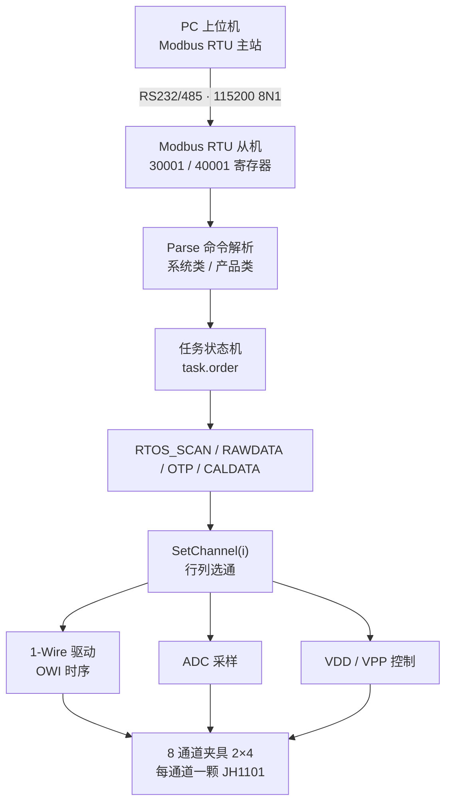

> ⚠️ **本文档已过期（2026-10-26）**
>
> 该工程已改为 **SAF8100 测试专用**，`JH1101.c/.h`、`RTOS_SCAN/RAWDATA/OTP/CALDATA`、
> 命令 `0x600/0x602/0x604/0x702/0x704`、`0x200`（VPP）均已删除。
> 本文仅作为 JH1101 版本的历史分析保留，当前实现请见 `Doc/SAF8100_Modbus适配说明.md`。
> 如无保留价值可直接删除本文件。

# SOP100E 测试治具固件分析报告

> 工程路径：`WF100E_DEMO`  
> 目标芯片：PY32F002B（Cortex-M0+，24MHz，24KB Flash / 6KB RAM）  
> 固件版本串：`8100 v1.0`（`product.h` 中 `FIRMWARE_VERSION`）  
> 分析日期：2026-10-26

---

## 1. 一句话定位

这是一个**多通道 OTP 烧写/测试治具的下位机固件**。上位机（PC 测试软件）作为 Modbus RTU 主站，通过串口下发指令；固件按通道逐个对夹具上的 8 颗 JH1101 芯片执行「扫描 → 读原始数据 → 烧写 OTP → 读校准 ADC」四种产线动作，并把结果回读到上位机。

- 无操作系统，裸机 + 简单状态机轮询。
- 通信协议：FreeModbus RTU 从机，从站地址 1，115200 8N1。
- 芯片接口：自研 1-Wire（OWI）位操作时序驱动。
- 夹具规模：2 行 × 4 列 = 8 通道。

---

## 2. 工程结构

| 目录 / 文件 | 作用 |
| --- | --- |
| `Src/main.c` | 初始化 HAL / GPIO / TIM1 / UART / ADC，启动 Modbus 从机，运行 `switch(task.order)` 任务调度主循环 |
| `Src/product.c` | **业务核心**：4 个任务的实现、通道选通 `SetChannel()`、通道与引脚映射表 |
| `Src/JH1101.c` | 1-Wire（OWI）底层驱动：复位脉冲、读写字节、`CMD_MODE()` / `NOR_MODE()`、命令读写封装 |
| `Src/CmdHelper.c` | 上位机命令解析 `Parse()`，系统命令 / 产品命令分派，VPP 与 VDD 控制 |
| `Src/gpio.c` `tim.c` `adc.c` `uart.c` | CubeMX 风格的外设初始化代码 |
| `Src/py32f002b_it.c` | 中断服务：SysTick、TIM14、USART1、ADC |
| `Inc/*.h` | 对应头文件；`product.h` 里定义了通道数、任务枚举、错误码、数据结构 |
| `Drivers/FreeModbus/` | FreeModbus 协议栈（RTU 模式）+ `port/` 移植层（串口、定时器、事件） |
| `Drivers/FreeModbus/Modbus.c` | 寄存器回调映射：输入寄存器 30001+（120 个）、保持寄存器 40001+（64 个） |
| `Drivers/PY32F002B_HAL_Driver/` | 普冉官方 HAL 库 |
| `Projects/MDK-ARM/` | Keil MDK 工程（`Project.uvprojx`），输出 `Project.hex` 等 |
| `Doc/SOP100E 2025.05.27.eprj` | 硬件工程源文件（SQLite 容器，立创EDA专业版格式），对应治具原理图 / PCB |
| `Doc/SOP100E_SCH_2026-10-21.pdf` | 原理图导出版（2 页，2026-10-21），含 VPP1~4、VDD1~4、OUT1~4_EN、PY32 主控，与本固件引脚定义一致 |

> 备注：Keil 的 include 路径里仍保留 `Drivers\FreeRTOS\...`，但该目录并不存在，属于模板残留，可清理。

---

## 3. 硬件资源映射

### 3.1 引脚定义（`main.h`）

| 功能 | 宏 | 引脚 | 说明 |
| --- | --- | --- | --- |
| 1-Wire 行 0 | `OUT1_Pin` | PA4 | 开漏输出，空闲拉高 |
| 1-Wire 行 1 | `OUT2_Pin` | PA3 | 开漏输出，空闲拉高 |
| 总电源使能 | `VDD_EN_Pin` | PB2 | 供上位机做上电复位 |
| 通道 VDD 1 | `VDD1_EN_Pin` | PA1 | 列选择 |
| 通道 VDD 2 | `VDD2_EN_Pin` | PA0 | 列选择 |
| 通道 VDD 3 | `VDD3_EN_Pin` | PB0 | 列选择 |
| 通道 VDD 4 | `VDD4_EN_Pin` | PB1 | 列选择 |
| 高压 VPP 使能 | `VPP_EN_Pin` | PB3 | OTP 烧写高压 |
| 串口 | — | PB4 / PB5 | USART1 TX / RX，AF1 |

### 3.2 通道矩阵（`product.c`）

```
JIG_ROW = 2, JIG_COL = 4, PRODUCT_NUM = 8, REG_NUM = 16

row = ch / 4   → 决定用 OUT1(PA4) 还是 OUT2(PA3)，以及 ADC 通道
col = ch % 4   → 决定用 VDD1 / VDD2 / VDD3 / VDD4

OWI_PORTS[2]   = { PA4, PA3 }
VDD_PORTS[4]   = { PA1, PA0, PB0, PB1 }
ADC_CHANNELS[] = { ADC_CHANNEL_2, ADC_CHANNEL_1 }   // 行0 / 行1
```

### 3.3 定时器与 ADC

| 资源 | 配置 | 用途 |
| --- | --- | --- |
| TIM1 | 24 分频 → 1MHz 计数，周期 65535 | `delay_us2()` 精确微秒延时（重装计数器法） |
| TIM14 | `xMBPortTimersInit()` 中动态配置：预分频 = PCLK/1MHz，周期 = 50us × n | Modbus T3.5 帧超时定时器 |
| ADC1 | 12bit，右对齐，采样时间 239.5 周期，单次软件触发 | 读取被测通道电压 / 校准值 |

### 3.4 中断优先级

| 中断 | 抢占优先级 | 处理内容 |
| --- | --- | --- |
| USART1 | 0（最高） | 直接调用 `pxMBFrameCBByteReceived()` / `pxMBFrameCBTransmitterEmpty()` |
| TIM14 | 3 | `eMBPoll()` + 条件调用 `pxMBPortCBTimerExpired()` |
| SysTick | 默认 | `HAL_IncTick()` |

---

## 4. 启动流程

```c
int main(void)
{
  HAL_Init();                 // 复位外设，初始化 SysTick
  MX_GPIO_Init();             // 所有控制脚初始为低，OWI 脚初始为高
  MX_TIM1_Init();             // 1us 计数基准，供 delay 使用
  MX_USART1_UART_Init();      // 115200 8N1
  MX_ADC1_Init();             // 12bit + 校准

  HAL_TIM_Base_Start(&htim1);

  eMBInit(MB_RTU, 1, 1, 115200, MB_PAR_NONE);  // 从站地址 1
  eMBEnable();

  HAL_TIM_Base_Start_IT(&htim14);              // 启动 Modbus T3.5 定时器

  while (1) { /* 任务状态机，见第 5 节 */ }
}
```

注意：`MX_TIM14_Init()` 定义了但**未被调用**，TIM14 实际由 `xMBPortTimersInit()` 重新初始化。

---

## 5. 运行时流程

### 5.1 主循环

```c
while (1)
{
    switch (task.order) {
        case TS_IDLE:    break;            // 空转，等待上位机下发
        case TS_SCAN:    RTOS_SCAN();      // 1 扫描 / 读 OTP
        case TS_RAWDATA: RTOS_RAWDATA();   // 2 读原始测量数据
        case TS_OTP:     RTOS_OTP();       // 3 烧写 OTP
        case TS_CALDATA: RTOS_CALDATA();   // 4 读校准 ADC
        default:
            task.isTaskBusy = 0;
            task.order = TS_IDLE;
    }
    HAL_Delay(1);
}
```

每个 `RTOS_xxx()` 函数内部都是「**for 8 个通道 → 逐个通道执行动作 → 记录结果**」的固定结构，并在结束时把 `task.order` 复位为 `TS_IDLE`、`task.prog` 置为 8。

### 5.2 整体数据通路



### 5.3 单通道操作时序


---

## 6. 四个任务详解

### 6.1 TS_SCAN —— 扫描 / 读 OTP（任务号 1）

对每个通道：

1. `SetChannel(i)`：切换到该通道的行列，并设置对应 ADC 通道。
2. `CMD_MODE()`：先断电 10ms → 上电 → 复位脉冲（14us 低 + 14us 高）→ 发 `0x80 0x10` 唤醒，读回响应字节。
3. `WRITE_CMD(0xFE, 0x02, 1, 8000, buf)`：进入 OTP 读取相关模式，校验 `buf[0]`（0 表示 ACK 正常）。
4. `WRITE_CMD(0xF0, 0x00, 17, 8000, buf)`：读 17 字节，前 16 字节为 OTP 内容，第 17 字节为校验字节（`buf[16]` 必须为 0）。
5. 存入 `product[i].otp[]`；`IsOtp = (otp[4] + otp[5]) != 0`，即用寄存器 4、5 是否非零判断「芯片是否已烧写过」。
6. `OWI_Idle()`：关闭该通道 VDD，总线恢复空闲高。

### 6.2 TS_RAWDATA —— 读原始数据（任务号 2）

1. 若 `product[i].errCode != 0`（上一轮扫描判为坏片），直接跳过。
2. `CMD_MODE()` 唤醒。
3. 循环 16 次 `WRITE_CMD(0x20 + j, otp[j], ...)`：把 OTP 里保存的 16 个配置字节写入芯片寄存器 `0x20 ~ 0x2F`。
4. `NOR_MODE()`：发 `0x80 0x30` 切到正常测量模式。
5. `READ_DAT(4, buf)`：取 4 字节测量结果（芯片内部 ADC 值），存入 `product[i].rawdata[0..3]`。

### 6.3 TS_OTP —— 烧写 OTP（任务号 3）

1. 跳过坏片 → `CMD_MODE()` → 写入 16 个配置寄存器（同 RAWDATA）。
2. **`SetProductVpp(0xFF)`**：拉高 VPP 高压（`VPP_EN` = PB3 置高）。
3. `WRITE_CMD(0x30, 0x80, ...)` → `WRITE_CMD(0xFF, 0x00, ...)` → `HAL_Delay(20)` 烧写窗口 → `WRITE_CMD(0x30, 0x00, ...)` 结束烧写。
4. `CMD_MODE()` 重新唤醒，`WRITE_CMD(0xF0, 0x00, 17, ...)` 回读 OTP。
5. 与 `product[i].otp[]` 逐字节比对，不一致返回 `ERR_OTP`。
6. 无论成败，`SetProductVpp(0x00)` 关闭高压 + `OWI_Idle()`。

### 6.4 TS_CALDATA —— 读校准数据（任务号 4）

1. 若 `task.paras[0] == 0xFF`：先 `CMD_MODE()` + 写入 16 个配置寄存器 + 切 `NOR_MODE()`，让芯片输出有效电压。
2. `HAL_Delay(10)` 等待稳定。
3. `GET_ADC_Value()`：把 OWI 引脚切为模拟输入，`APP_ADCConvert(channel)` 采样，得到 12bit 值。
4. 把 32bit ADC 值拆成 4 字节存入 `product[i].rawdata[0..3]`。

> 这里的 ADC 值走的是 MCU 自己的 ADC 通道，与 RAWDATA 读的「芯片内部 ADC 值」是两条不同的数据来源，分别用于校准与测量。

---

## 7. Modbus 命令协议

### 7.1 寄存器分区

| 区域 | 地址 | 长度 | 用途 |
| --- | --- | --- | --- |
| 输入寄存器 | 30001 ~ 30120 | 120 字 | 固件 → 上位机的**结果缓冲区** `sendBuf[]` |
| 保持寄存器 | 40001 ~ 40064 | 64 字 | 上位机 → 固件的**命令缓冲区** `recvBuf[]` |

工作方式：上位机**写保持寄存器**下发命令 → `eMBRegHoldingCB()` 在 `MB_REG_WRITE` 时调用 `Parse()` 并把结果填进 `sendBuf` → 上位机**读输入寄存器**取回结果。

### 7.2 命令表

`recvBuf[0]` 为命令大类，`recvBuf[1]` 为具体命令。

**系统类（`recvBuf[0] = 1`）**

| 命令码 | 含义 | 参数 / 返回 |
| --- | --- | --- |
| `0x104` | 读固件版本 | 返回 ASCII `"8100 v1.0"` |
| `0x200` | 设置 VPP | `recvBuf[2]`：`0xFF` = 开高压，其他 = 关 |
| `0x201` | 设置总 VDD（PB2） | `recvBuf[2]`：`0xFF` = 开 |

**产品类（`recvBuf[0] = 5`）**

| 命令码 | 含义 | 参数 / 返回格式 |
| --- | --- | --- |
| `0x66` | 读任务状态 | 返回 busy / order / prog / paras[0..3]，共 7 个寄存器 |
| `0x77` | **下发任务** | `recvBuf[2]` = 任务号(0~4)，`recvBuf[3..6]` = 4 个参数；同时置 `isTaskBusy=1`、`prog=0` |
| `0x600` | 读产品状态 | 起始通道号；每颗 1 个寄存器：bit15 = IsOtp，低 8 位 = errCode（一次最多 120 颗） |
| `0x602` | 读原始数据 | 起始通道号；每颗 3 个寄存器：`errCode<<8\|raw0`、`raw1<<8\|raw2`、`raw3<<8\|raw4`（一次最多 40 颗） |
| `0x604` | 读 OTP 数据 | 起始通道号；每颗 8 个寄存器（16 字节，大端拼装，一次最多 15 颗） |
| `0x702` | 写 OTP 数据 | 通道号 + 16 字节，写入 `product[ch].otp[]` |
| `0x704` | 关闭通道 | 通道号 + 错误码，直接把 `product[ch].errCode` 置为指定值（上位机人为判不良，通常传 `0xF0`） |

### 7.3 错误码（`ERROR_CODE`，1 字节）

| 值 | 名称 | 含义 |
| --- | --- | --- |
| `0x00` | 正常 | 任务执行成功 |
| `0xA5` | `ERR_NONE` | 保留的「无错误」常量 |
| `0x01` | `ERR_CMD` | 命令模式无响应 |
| `0x02` | `ERR_NOR` | 无法进入正常模式 |
| `0x03` | `ERR_ACK` | ACK 校验失败 |
| `0x04` | `ERR_PARAM` | 参数异常 |
| `0x05` | `ERR_SOFTRESET` | 软复位相关 |
| `0x06` | `ERR_OTP` | OTP 回读校验不一致 |
| `0xF0` | `ERR_CLOSED_BYPC` | 被上位机强制关闭通道 |

---

## 8. 关键数据结构

```c
typedef struct Product {
    uint8_t  errCode;              // 0 = 正常，非 0 见错误码表
    uint8_t  IsOtp : 1;            // 是否已烧写 OTP
    uint8_t  rawdata[5];           // 最近一次的原始数据
    uint8_t  otp[REG_NUM];         // 16 字节 OTP / 配置内容
} Product;

typedef struct Task {
    TasksOrder order;              // 当前任务号
    uint8_t    paras[5];           // 4 个参数（paras[0..3]）
    uint8_t    isTaskBusy : 1;     // 忙标志
    uint16_t   prog;               // 进度：当前处理到第几个通道
} Task;

typedef enum {
    TS_IDLE = 0, TS_SCAN, TS_RAWDATA, TS_OTP, TS_CALDATA, TS_MAX
} TasksOrder;
```

---

## 9. 1-Wire（OWI）时序要点

所有位操作都用 `__disable_irq()` 关全局中断保护，保证微秒级时序不被 UART / 定时器中断打断。

| 动作 | 时序 |
| --- | --- |
| 写 `1` | 拉低 5us → 拉高 22us |
| 写 `0` | 拉低 22us → 拉高 5us |
| 复位 / 同步头 | 拉低 14us → 拉高 14us，随后发 `0x80 0x10` 唤醒 |
| 写字节 | 8 位数据 + 1 位奇偶校验位（逐位异或），之后额外延时 25us |
| 读字节 | 等下降沿 → 等上升沿 → 等下降沿，逐位比较高 / 低电平持续时间判断 0/1，末尾补一个上升沿等待 |

`CMD_MODE()` 的实现是「**断电 → 重新上电 → 复位 → 唤醒**」，这是让芯片进入命令模式的唯一途径，因此每次访问通道都伴随一次电源循环。

---

## 10. 发现的问题与风险

### 10.1 【确认是 Bug】OTP 校验判断条件错误

`Src/product.c` 的 `RTOS_OTP()`：

```c
for (j = 0; j < 16; j++) {
    if (product[i].otp[j] != buf[j]) break;
}
err = (j == 17) ? 0 : ERR_OTP;      // ← 问题在这里
```

16 字节全部相同时，循环正常结束，此时 `j == 16`，永远不会等于 17，因此**即使烧写完全正确也会返回 `ERR_OTP(6)`**。

**修复建议**：改为 `err = (j == 16) ? 0 : ERR_OTP;`  
更稳妥的写法：

```c
err = (memcmp(product[i].otp, buf, 16) == 0) ? 0 : ERR_OTP;
```

### 10.2 【架构风险】Modbus 协议栈运行在定时器中断中

`py32f002b_it.c` 的 `TIM14_IRQHandler()` 每次中断都调用 `eMBPoll()`（周期 50us 级），协议栈全部在中断上下文执行。而 OWI 位操作会 `__disable_irq()` 关闭全局中断数微秒到数十微秒。带来的问题：

- 关闭中断期间若上位机正在发帧，可能丢字节导致整帧 CRC 错误；
- `eMBPoll()` 在中断里执行耗时不确定，会干扰 T3.5 计时精度；
- 中断嵌套 + 长任务，容易偶发通信异常。

**建议**：改为「UART 中断只做收字节 + 置标志」，`eMBPoll()` 放到主循环里轮询。

### 10.3 【已复核撤回】错误上报实际是正常的

> **更正说明（2026-10-26）**：本条初版判断为「错误被主动屏蔽」，逐行复核后**该判断错误，予以撤回**。

初版误判的依据是 `RTOS_SCAN()` / `RTOS_RAWDATA()` / `RTOS_CALDATA()` 末尾都有一句 `err = 0;`。复核后确认这句位于 `do { ... } while (0)` **块内部**：

```c
do {
    task.prog++;
    err = 0;
    ...
    BREAK_ASSERT2(CMD_MODE(), err, ERR_CMD);   // 失败时：err = 错误码; break;
    ...
    //任务完成
    err = 0;        // ← 只有全部成功时才会执行到这里
} while (0);
```

`BREAK_ASSERT2` 的展开是 `if (ERR_NONE != b) { v = e; break; }`，失败时 `break` 直接跳出 `do-while`，**跳过**了末尾这句 `err = 0`；只有在全部步骤成功、`err` 本来就是 0 的情况下才会执行它。因此这句是**冗余空操作**，并不会覆盖错误码。

结论：**错误码能正常上报到上位机**，`errCode` 可信（前提是修掉 10.1 的 OTP 判定问题）。原注释 `//任务完成`（GBK 还原后）也印证了作者意图是标记阶段结束，而非屏蔽错误。

建议：清理这句冗余赋值，避免后续维护者误读。

### 10.4 【功能风险】VPP 高压设置结果未校验

`RTOS_OTP()` 中 `SetProductVpp(0xFF)` 的返回值被忽略，`SetProductVpp()` 本身会回读引脚状态，但没有判断。若高压未真正建立，芯片烧不进去却仍走完流程，最终只靠（本来就有 Bug 的）OTP 校验兜底。

### 10.5 【健壮性】无看门狗、无故障恢复

- 未启用 IWDG；
- `HardFault_Handler()` 与 `APP_ErrorHandler()` 都是 `while(1)` 死循环；
- 产线治具建议：启用 IWDG（例如 1~2s），HardFault 中记录标志后软复位，避免治具"假死"需要人工断电。

### 10.6 【代码整洁】残留配置与未使用代码

- Keil include 路径含不存在的 `Drivers\FreeRTOS\...`；
- `MX_TIM14_Init()` 定义但从未调用；
- `main.c` 中 `delay_us2()` 已实现但未被使用（实际用的是 NOP 循环版 `delay_us()`，`3×us` 个空转，精度依赖编译器优化等级）；
- `JH1101.c` 中 `READ_DAT()` 使用全局变量 `tim` 且未在入口清零，第二次调用时 `while(tim < 100)` 可能一次都不进循环；
- `product.h` 声明了 `RTOS_GET_OTPDATA()` / `RTOS_SET_OTPDATA()` 但并无实现（功能已改为走 Modbus 寄存器直接操作 `product[]`）。

### 10.7 【已于 2026-10-26 修复】源码中文注释编码混乱

修复前工程里存在三种编码状态并存：

| 文件 | 修复前状态 | 处理方式 |
| --- | --- | --- |
| `product.c` `JH1101.c` `product.h` `JH1101.h` | GBK 编码，内容完好 | 无损转码为 UTF-8 |
| `CmdHelper.c` | UTF-8，但 4 行注释被「UTF-8 当 GBK」二次错位 | 定点还原 4 处 |
| `main.c` | 注释已被替换字符 `锟斤拷` 彻底破坏，原文不可逆 | 按代码语义重写 2 处 |

修复后全工程 `.c/.h/.s` 均为**合法 UTF-8（无 BOM）**，无替换字符残留，换行符（CRLF）与代码本体未改动，字符串常量中无中文，因此不影响编译与运行。

> 编码约定：**全工程统一 UTF-8（无 BOM）**。
> Keil MDK 需设置 `Edit → Configuration → Editor → Encoding = UTF-8` 才能正确显示中文；
> 改动前的原始文件备份在 `.workbuddy/backup/2026-10-26_encoding/`。

---

## 11. 上位机对接速查

1. 读版本：写 `40001 = 1`、`40002 = 0x104` → 读 `30001 起 N 个寄存器` → ASCII 拼接。
2. 下发扫描：写 `40001=5, 40002=0x77, 40003=1, 40004..40007=参数`。
3. 轮询进度：反复写 `40001=5, 40002=0x66` → 读 `30001`（busy）、`30002`（order）、`30003`（prog，0~8）。
4. 任务结束后：写 `0x600` 读每颗状态（bit15 = 已烧写，低字节 = 错误码）；写 `0x602` 读原始数据；写 `0x604` 读 OTP。
5. 人为判不良：写 `0x702` 改 OTP 内容 / 写 `0x704` 直接置错误码。

---

## 12. 文件与函数速查表

| 功能 | 入口函数 | 所在文件 |
| --- | --- | --- |
| 主流程 | `main()` | `Src/main.c` |
| 任务分派 | `switch (task.order)` | `Src/main.c` |
| 命令解析 | `Parse()` → `ParseSystemCmd()` / `ParseProductCmd()` | `Src/CmdHelper.c` |
| 通道选通 | `SetChannel()` | `Src/product.c` |
| 扫描 | `RTOS_SCAN()` | `Src/product.c` |
| 读原始数据 | `RTOS_RAWDATA()` | `Src/product.c` |
| 烧写 OTP | `RTOS_OTP()` | `Src/product.c` |
| 读校准 | `RTOS_CALDATA()` | `Src/product.c` |
| 1-Wire 底层 | `OWI_WRITE_STAR / OWI_WRITE_DATA_BYTE / OWI_READ_DATA_BYTE` | `Src/JH1101.c` |
| 模式切换 | `CMD_MODE()` / `NOR_MODE()` | `Src/JH1101.c` |
| 命令封装 | `WRITE_CMD()` / `READ_DAT()` | `Src/JH1101.c` |
| ADC 采样 | `APP_ADCConvert()` / `GET_ADC_Value()` | `Src/adc.c` / `Src/JH1101.c` |
| 寄存器回调 | `eMBRegHoldingCB()` / `eMBRegInputCB()` | `Drivers/FreeModbus/Modbus.c` |
| 串口移植 | `vMBPortSerialEnable()` 等 | `Drivers/FreeModbus/port/portserial.c` |
| 定时器移植 | `xMBPortTimersInit()` 等 | `Drivers/FreeModbus/port/porttimer.c` |

---

## 13. 建议的下一步

按优先级排列：

1. **修 `RTOS_OTP()` 的 `j == 17` → `j == 16`**（当前 OTP 烧写结果判定完全失效）。
2. **恢复错误上报**：去掉 `err = 0;` 的屏蔽，或加参数开关控制。
3. **Modbus 轮询移出中断**，降低通信异常概率。
4. **增加 VPP 拉起校验与超时保护**。
5. **启用 IWDG + 故障自恢复**，适配产线长期运行。
6. 清理残留配置（FreeRTOS 路径、`MX_TIM14_Init`、`delay_us2`）。
